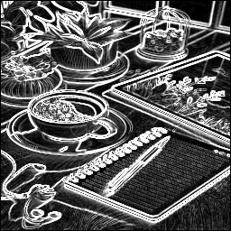

# 🔬 Sobel Edge Detection — FPGA Hardware Implementation

**Author:** Sithum Sathsara Vitharana &nbsp;|&nbsp; **Reg. No:** E/21/420

A complete, two-milestone hardware implementation of the **Sobel Edge Detection** algorithm in **Verilog HDL**, progressing from a software-verified behavioural simulation to a real-time, live FPGA display over VGA.

---

## 🗺️ Project Roadmap

```
sobel-filter-verilog/
├── milestone-1/    ← Behavioural simulation + automated pipeline
└── milestone-2/    ← Real-time VGA display on FPGA hardware
```

| Milestone | Description | Output |
|-----------|-------------|--------|
| [Milestone 1](./milestone-1/README.md) | Sobel filter simulated in Xilinx Vivado with a fully automated batch pipeline | `output_image.jpg` side-by-side comparison |
| [Milestone 2](./milestone-2/README.md) | Sobel filter synthesised and deployed on FPGA — live split-screen output on a VGA monitor | Real-time edge map on physical display |

---

## ⚙️ Tech Stack

| Layer | Tools |
|-------|-------|
| Hardware Description | Verilog HDL |
| FPGA Toolchain | Xilinx Vivado 2019.2 |
| Image Pre/Post-processing | Python 3 · OpenCV · NumPy · Matplotlib |
| Target Hardware (M2) | Basys 3 / Nexys FPGA Board |

---

## 🧠 How the Sobel Filter Works

The Sobel operator computes the **image gradient** by convolving a 3×3 pixel window with two kernels — one for horizontal edges (Gx) and one for vertical (Gy):

```
Gx Kernel          Gy Kernel
-1  0  +1          -1  -2  -1
-2  0  +2           0   0   0
-1  0  +1          +1  +2  +1
```

The final edge magnitude is approximated as:

**G ≈ |Gx| + |Gy|**

This Manhattan-distance approximation avoids expensive square-root hardware while still producing sharp, accurate edges — a classic FPGA optimisation.

---

## 📸 Results

| Original Image | Sobel Edge Output |
|:--------------:|:-----------------:|
|  |  |

---

## 📁 Repository Structure

```
sobel-filter-verilog/
│
├── milestone-1/
│   ├── src/
│   │   ├── sobel_calc.v          # Core Sobel combinational logic
│   │   └── tb_sobel.v            # Testbench — drives 256×256 image
│   ├── scripts/
│   │   ├── generate_hex.py       # JPG → HEX pre-processor
│   │   ├── generate_image.py     # HEX → JPG post-processor
│   │   └── show_results.py       # Side-by-side Matplotlib viewer
│   ├── simulation/
│   │   ├── run_sim.tcl           # Headless Vivado simulation script
│   │   └── FULL_AUTO.bat         # One-click full pipeline runner
│   ├── test_image.jpg            # Sample input image
│   └── output_image.jpg          # Sample Sobel output
│
├── milestone-2/
│   ├── src/
│   │   ├── top_sobel_display.v   # Top-level: glues all modules + VGA
│   │   ├── sobel_calc.v          # Pipelined Sobel calculation
│   │   ├── vga_controller.v      # VGA 640×480 @ 60Hz timing
│   │   ├── pixel_window.v        # 3×3 sliding pixel window
│   │   ├── line_buffer.v         # Line buffer for window generation
│   │   ├── output_row_buffer.v   # Row buffer for split-screen output
│   │   └── image_rom.v           # Block RAM image ROM
│   ├── generate_hex.py           # PNG → HEX for ROM initialisation
│   └── input_image.png           # Sample image loaded into ROM
│
├── .gitignore
└── README.md
```
